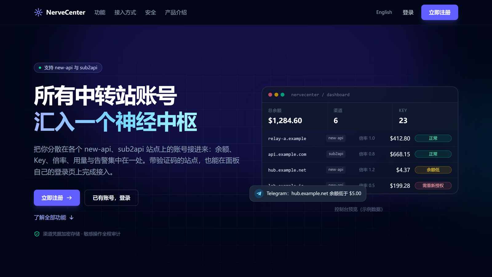
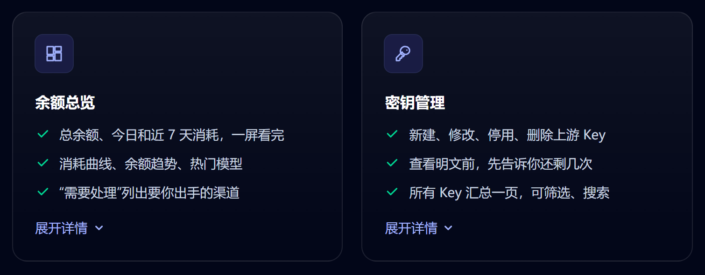
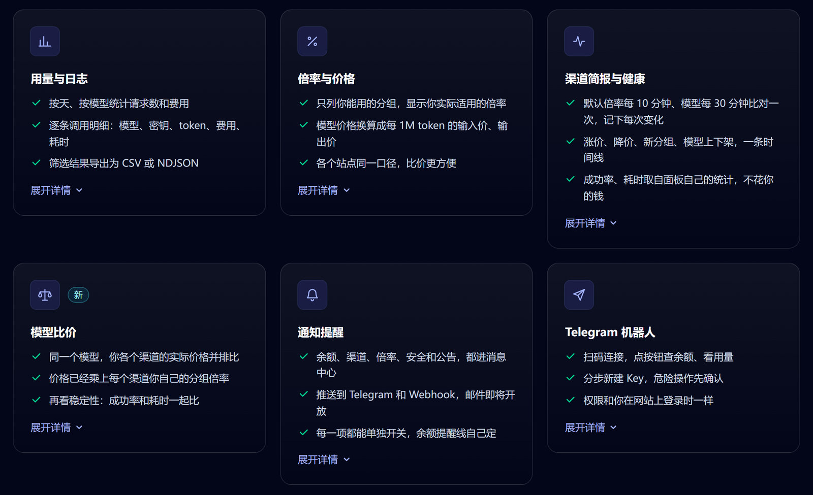
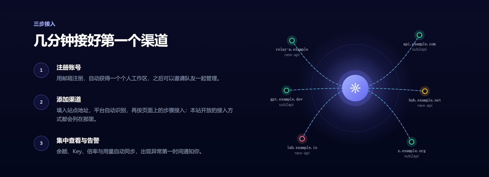
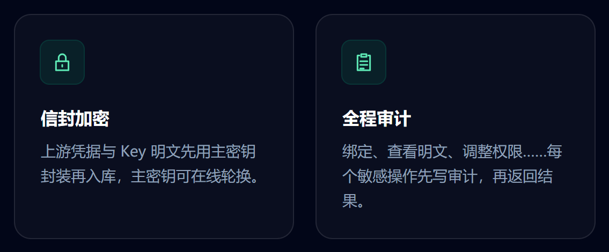
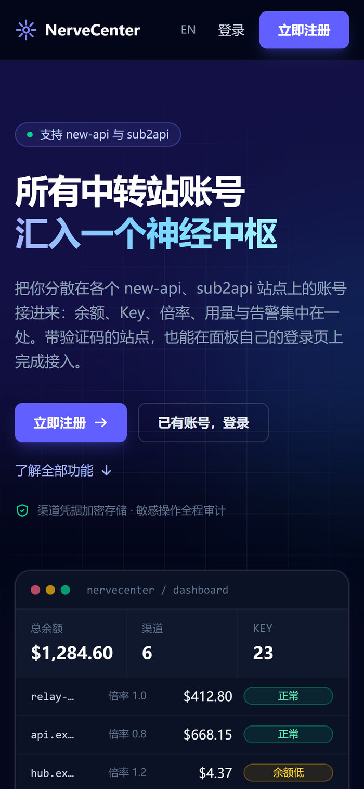
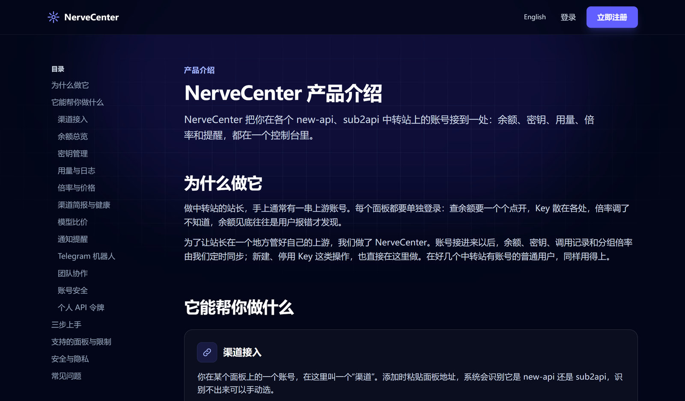
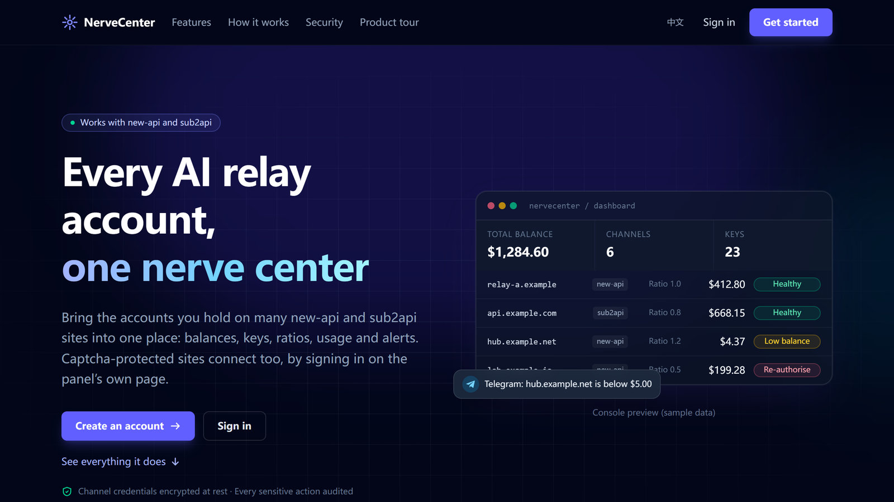

<h1 align="center">NerveCenter</h1>

<p align="center">
  new-api / sub2api 中转站账号管理中心：多站点的余额、API Key、用量、分组倍率和提醒，放在一个控制台里。
</p>

<p align="center">
  <a href="https://nvcenter.cc"></a>
  
  <a href="https://t.me/NerverCenter_bot"></a>
  
</p>

<p align="center">
  <a href="https://nvcenter.cc">在线使用</a> ·
  <a href="https://nvcenter.cc/intro">产品介绍</a> ·
  <a href="docs/product-intro.zh.md">完整介绍（文档）</a> ·
  <a href="#english">English</a>
</p>

<p align="center">
  
</p>

> [!NOTE]
> 本仓库只包含产品介绍、几张网站截图和一小部分网页前端代码，用于展示，不是完整源码，也无法单独构建运行。NerveCenter 服务本身不开源。

## 适合谁

- **中转站站长**：手上有一串上游账号，每个面板都要单独登录。查余额要一个个点开，Key 散在各处，倍率调了不知道，余额见底往往是用户报错才发现。
- **在多个中转站都有账号的用户**：想知道同一个模型在哪个站最便宜、最稳。

你在某个 new-api 或 sub2api 面板上的一个账号，在这里叫一个“渠道”。接进来以后，余额、Key、调用记录和分组倍率由 NerveCenter 定时同步。

## 多站点总览：余额、Key 和用量

<p align="center">
  
</p>

- **中控台**：当前工作区所有渠道的总余额、今日和近 7 天消耗、近 14 天消耗曲线、30 天余额趋势、近 7 天热门模型，也可以按平台分开看。
- **需要处理**：需重新授权、余额不足、凭据即将过期、同步出错、上游故障的渠道集中列出，点进去就能处理。
- **API Key 管理**：不登录面板也能新建、修改、停用、重新启用、删除上游 Key。所有 Key 汇总在一页，可以按渠道、平台、状态、分组筛选，并显示每把 Key 所在分组的倍率。
- **用量日志**：按天、按模型统计请求数和费用，逐条调用明细（模型、密钥、分组、输入/输出 token、费用、耗时），筛选结果可导出为 CSV 或 NDJSON。

## 倍率、模型比价与提醒

<p align="center">
  
</p>

- **倍率与价格**：只列你能用的分组，显示你本人实际适用的倍率。模型价格统一换算成每 1M token 的输入价和输出价，按次计费的显示每次价格，各个站点同一口径。
- **渠道简报**：面板本身不保留倍率和模型的变更历史，NerveCenter 默认每 10 分钟比对一次分组倍率、每 30 分钟比对一次模型列表，涨价、降价、新分组、分组下线、模型上下架都记在近 7、30、90 天的时间线里。
- **健康数据**：读取面板自己统计的成功率、平均耗时、首字耗时、输出速度（sub2api 读取渠道监控数据）。不用你的 Key 发测试请求，不产生费用。
- **模型比价**：同一个模型，在你各个渠道上的价格（站点模型价 × 你在这个渠道的分组倍率）和稳定性放在一起比，每类模型挑出最便宜、最稳、最划算的渠道，可排序、筛选、导出 CSV。
- **通知提醒**：余额预警、渠道异常、倍率与模型变化、安全提醒和平台公告进站内消息中心，也可以推送到 Telegram 或 Webhook（带 HMAC-SHA256 签名）。每一项都能单独开关，余额提醒线自己定。倍率、分组和模型的变化检测到后几秒内推送。

简报里的几条记录（示例）：

```text
今天   涨价    default 分组倍率上调 ×1 → ×1.2
昨天   新分组  新增分组 vip
昨天   上架    vip 分组上架 3 个模型
```

## 怎么接入一个中转站

<p align="center">
  
</p>

添加渠道时粘贴面板地址，系统会识别它是 new-api 还是 sub2api，识别不出来可以手动选。

接入的难点在于面板只认浏览器里的登录，而登录往往带验证码。所以登录始终由你本人完成，有三种办法，添加渠道时页面上会列出当前开放的几种（开放哪几种由站点运营方决定）：

- **从浏览器复制登录（F12，默认）**：在你自己的浏览器里正常登录面板，验证码照常完成，再按页面上的图文教程把登录凭据复制过来。不用装任何东西。
  - **new-api**：推荐“一行命令 + 面板密码”，在面板标签页的控制台运行一行命令，输入一次面板密码，自动生成访问令牌（180 天后过期，到时重新授权）。也可以复制 Cookie，或在面板里手动创建访问令牌。
  - **sub2api**：在面板标签页的控制台运行一行命令复制登录凭据，然后立刻清除网站数据，再粘贴回来。
- **浏览器扩展**：在你自己的浏览器里登录面板，由 NerveCenter Connector 扩展把登录交给我们。站内直接下载 zip，解压后手动加载（不在应用商店里），用一次性配对码和账号配对一次即可，之后不用再填服务器地址。只支持 Chrome、Edge 这类 Chromium 浏览器。适合要接入好几个面板的人。
- **云浏览器**：在我们服务器上的临时浏览器里打开面板自己的登录页，你照常登录、完成验证码，我们只保存登录后的会话。本机什么都不用装。这台浏览器用完即弃，同时在用的数量有限。注意：云浏览器里不能用第三方账号登录（如“用 Google 登录”），这种账号请用前两种方式。

三种方式保存下来的东西是一样的，接入之后没有区别。

添加时可以选“仅自己”或“团队共享”。首次同步一般要一两分钟，还会回溯一段历史用量。每个渠道接入后会逐项检测面板能力，每天复检一次；面板没有某项功能时会直接说明原因，不会莫名报错。

<details>
<summary><b>支持的面板与限制</b></summary>

- 支持 new-api（以及能识别出的改版面板）和 sub2api。其他面板会提示“该地址上没有找到支持的面板”。
- 云浏览器里不能用第三方账号登录（如“用 Google 登录”）；浏览器扩展需手动加载，不在 Chrome 应用商店里，只支持 Chromium 浏览器。
- 无法代你完成通行密钥（Passkey）验证。只能用通行密钥验证的 new-api 账号用不了“一行命令”，请改用复制 Cookie 或手动创建访问令牌。
- 部分 sub2api 站点会把登录和 IP、浏览器绑定，复制过来的登录可能被站点撤销，这时需要重新授权。
- 健康数据只在较新版本的 new-api，或开了渠道监控的 sub2api 上才有。
- 有的面板限制日志的查询跨度，更早的历史可能回溯不全，页面上会注明。
- 用量导出单次最多 10 万行。
- 本站暂未开通邮件，不能通过邮件找回密码或关闭两步验证。

</details>

## 安全

<p align="center">
  
</p>

- **凭据加密**：上游凭据和查看过的 Key 明文，入库前都用主密钥加密封装；每条上游凭据有自己的数据密钥，用 AES-256-GCM 加密。
- **管理员也看不到**：平台管理员看不到你的上游凭据。管理员如需查看某把 Key 的明文，只能逐把查看，要先通过两步验证，每次都记入审计。
- **全程审计**：绑定渠道、查看明文、调整权限等敏感操作，先写审计再返回结果，审计不记录任何令牌和密码。查看明文有频率限制，默认还会给你发安全提醒。
- **密码不经过我们**：“一行命令”里的面板密码只发给面板本身，不经过 NerveCenter；sub2api 的复制命令只把登录信息复制到你的剪贴板。
- **账号安全**：账号密码只保存 argon2id 哈希。两步验证附带 10 个一次性恢复码；可以查看每台登录设备、单独让它退出；登录、改密码等记录都在安全动态里。没有手机时，[两步验证工具](https://nvcenter.cc/tools/2fa)在你的浏览器里算出验证码，密钥不发送、不保存。

从面板复制出来的登录凭据，作用和你本人登录一样。只把它粘贴到你信任的 NerveCenter。

## 手机上也能用

<table>
<tr>
<td width="300" valign="top">

</td>
<td valign="top">

网站适配手机屏幕，出门在外也能打开查看。

不方便开网页时，用官方 Telegram 机器人 [@NerverCenter_bot](https://t.me/NerverCenter_bot)：

- **连接**：在“通知设置 → 推送渠道”点“连接 Telegram”，扫码或点链接后按“开始”。连接码 10 分钟内有效，只能用一次。
- **查看**：发送 `/menu`，点按钮查看余额总览、我的渠道、今日用量、倍率变化。
- **管理 Key**：分步新建（名称、分组、额度、有效期）；停用、删除、查看完整密钥都要先确认，完整密钥过一会儿自动删除。
- **推送设置**：余额预警、渠道异常、倍率与分组、新模型、安全提醒、平台公告，六个开关。

机器人只响应私聊，权限和你在网站上登录时一样。

</td>
</tr>
</table>

## 团队与自动化

- **工作区**：渠道和成员放在工作区里，可以新建多个，在顶部随时切换。
- **邀请与角色**：按邮箱邀请，角色有管理员、操作员、只读成员。渠道可以设为“仅自己”或“团队共享”，管理密钥、查看明文等权限单独授予。所有者和管理员可以查看审计日志。
- **个人 API 令牌**：给脚本和自动化工具用。权限按需勾选（只读、管理密钥、查看密钥明文、触发同步、修改渠道名称），有效期 1 到 365 天或永不过期。令牌能做的永远不超过你本人，也不能绑定或删除渠道、管理成员、改密码和两步验证。
- **问题反馈**：在网站上提交问题，随时看到是否采纳和处理进度。

## 三步上手

1. **注册**：打开 [nvcenter.cc](https://nvcenter.cc)，用邮箱注册，注册后直接进入你的工作区。
2. **添加第一个渠道**：“渠道 → 添加渠道”，粘贴面板地址，点“识别站点”，按页面上的步骤复制登录，点“连接”。
3. **看中控台**：一两分钟后，余额、Key 和用量就会出现。顺手设一条余额提醒线、连上 Telegram，再开两步验证，把恢复码存好。

## 完整产品介绍

每项功能的细节、限制和常见问题，在网站的[产品介绍页](https://nvcenter.cc/intro)和本仓库的 [docs/product-intro.zh.md](docs/product-intro.zh.md) 里（English: [docs/product-intro.en.md](docs/product-intro.en.md)）。

<p align="center">
  
</p>

## 本仓库包含什么

```
docs/product-intro.zh.md          完整产品介绍（中文）
docs/product-intro.en.md          Full product introduction (English)
docs/images/                      README 用到的网站截图
web/src/pages/Landing.tsx         首页
web/src/pages/Intro.tsx           产品介绍页
web/src/components/landing/       首页插图、控制台预览和功能介绍
web/src/components/ui.tsx         通用界面组件
web/src/lib/messages.landing.ts   首页文案（中英）
web/src/index.css                 全局样式
```

前端使用 React、TypeScript 和 Tailwind CSS。这些文件引用了未公开的模块，无法单独构建。

## 链接

- 网站：https://nvcenter.cc
- 产品介绍：https://nvcenter.cc/intro
- 两步验证工具（没有手机时使用，验证码只在浏览器里计算）：https://nvcenter.cc/tools/2fa
- Telegram 机器人：https://t.me/NerverCenter_bot

## English

<p align="center">
  
</p>

NerveCenter brings your accounts on many **new-api** and **sub2api** relay panels (中转站) into one console: balances, upstream API keys, usage logs, group ratios (倍率), model price comparison and alerts. It is built for relay-site owners with many upstream accounts, and for anyone with accounts on several sites. Each connected account is a "channel", synced on a schedule.

### Multi-site overview

- Total balance, today's and 7-day spend, spend and balance trends, and top models across every channel.
- A "needs attention" list: re-authorisation needed, low balance, credentials about to expire, sync errors, upstream faults.
- Create, edit, disable, re-enable and delete upstream API keys without signing in to each panel; filter all keys by channel, platform, status and group.
- Usage logs by day and by model with per-call detail, exportable as CSV or NDJSON.

### Ratios, price comparison and alerts

- Only the groups you can use, at the ratio that applies to you; model prices in USD per 1M input and output tokens, the same way on every site.
- A timeline of ratio, group and model changes (by default ratios are compared every 10 minutes, model lists every 30), since panels keep no history of their own.
- Panel health (success rate, latency) read from the panel's own statistics. No test requests with your keys, no cost.
- Model price comparison: each model's price on each of your channels, with your own group ratio applied, next to its stability.
- Alerts in the in-app inbox, on Telegram or by HMAC-SHA256-signed webhook, each switchable on its own.

### Connecting a panel

Paste the panel address and NerveCenter detects new-api or sub2api. You always sign in yourself, captcha and all, in one of three ways; the add page lists whichever the site has open.

- **Copy the sign-in from your browser (F12, the default)** — sign in to the panel in your own browser, then copy the sign-in over following the illustrated steps. Nothing to install. On new-api the recommended route is one console command plus your panel password, which creates an access token; the password goes only to the panel.
- **Browser extension** — sign in to the panel in your own browser and the NerveCenter Connector extension hands the sign-in over. Downloaded from the site and loaded unpacked (not in the Chrome Web Store), paired to your account once with a one-time code. Chromium browsers only.
- **Cloud browser** — the panel's own sign-in page opens in a throwaway browser on our server. You sign in as usual and we keep only the resulting session. Third-party sign-in ("continue with Google") does not work there; use one of the other two for such an account.

All three store the same thing, and a channel behaves the same once connected. Other panel software is not supported.

### Security

- Upstream credentials and revealed keys are sealed under a master key before they are stored; each credential has its own AES-256-GCM data key.
- Platform admins cannot see your upstream credentials. An admin can reveal a key only one at a time, after two-step verification, and every reveal is audited.
- Sensitive actions are recorded in the audit log before their result goes out.
- Account passwords are stored only as argon2id hashes. Two-step verification with recovery codes, device sign-out, team workspaces with roles, and scoped personal API tokens.

### On your phone

The site fits a phone screen, and the official Telegram bot [@NerverCenter_bot](https://t.me/NerverCenter_bot) shows balances, channels, today's usage and ratio changes, manages keys with confirmation steps, and lets you choose which alerts it sends.

### Getting started

1. Sign up at [nvcenter.cc](https://nvcenter.cc) with your email.
2. Add a channel: paste the panel address and follow the steps on the page.
3. In a minute or two your balances, keys and usage appear on the dashboard. Set a balance alert, connect Telegram and turn on two-step verification.

Full details: [docs/product-intro.en.md](docs/product-intro.en.md) (English) · [docs/product-intro.zh.md](docs/product-intro.zh.md) (中文) · https://nvcenter.cc/intro

This repository holds only the product introduction, a few screenshots of the site and a small excerpt of the web front end, for reference. It isn't the full source and doesn't build on its own. NerveCenter is a closed-source service: https://nvcenter.cc

## 版权 / Copyright

© NerveCenter. 保留所有权利。本仓库代码仅供展示，未授予开源许可。详见 [LICENSE](LICENSE)。

All rights reserved. The code here is shown for reference only; no open-source licence is granted. See [LICENSE](LICENSE).
